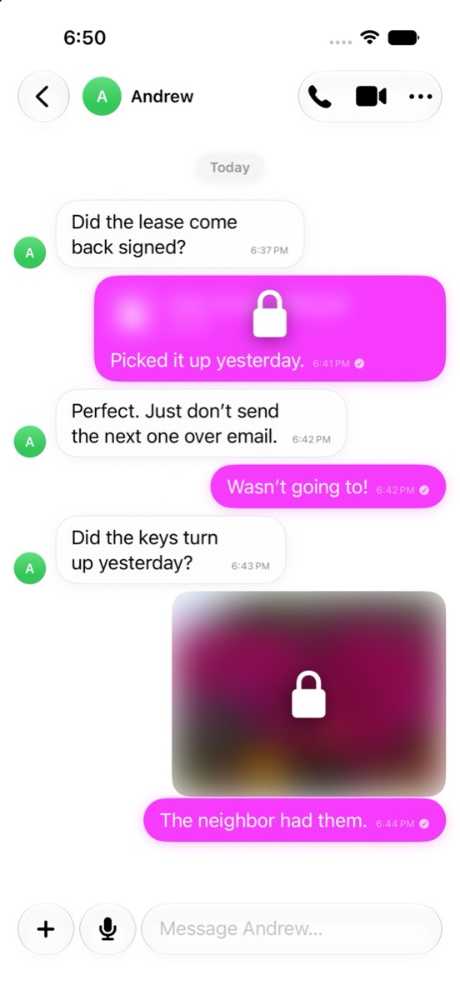

<p align="center">
  <picture>
    <source media="(prefers-color-scheme: dark)" srcset=".github/assets/relay-logo-light-ink.png">
    
  </picture>
</p>

<h3 align="center">Say anything.</h3>

<p align="center">
  An end-to-end encrypted messenger for iPhone.<br>
  Messages are deleted from our servers the moment they arrive.
</p>

<p align="center">
  <a href="https://relaymsg.app"><b>Website</b></a> ·
  <a href="https://relaymsg.app/security"><b>How it works</b></a> ·
  <a href="https://relaymsg.app/privacy"><b>Privacy</b></a> ·
  <a href="SECURITY.md"><b>Report a vulnerability</b></a>
</p>

<p align="center">
  <a href="LICENSE"></a>
  
  
  
</p>

<p align="center">
  <picture>
    <source media="(prefers-color-scheme: dark)" srcset=".github/assets/screenshot-dark.jpg">
    
  </picture>
</p>

## Features

- 🔐 **End-to-end encrypted.** The Signal Protocol with a post-quantum key exchange (PQXDH), for chats, groups, calls and media.
- 🕶️ **Sealed sender.** Messages don't say who sent them, and the server keeps no record of who talks to whom.
- 🗑️ **Delivered means deleted.** The server holds a message only until your phone collects it, then deletes it.
- 👥 **Private groups.** The server keeps no group list: no names, members or admins.
- 📞 **Encrypted calls.** Voice and video, one-to-one or in groups, relayed by default so the other side never sees your IP address.
- 🔑 **No phone number.** Sign up with a username and a passkey; an email is optional.
- ⏳ **Disappearing messages.** Set a timer and messages go from every device in the chat.
- ☁️ **Encrypted backups.** Optional iCloud backups, encrypted with a key only you hold.

## What's in this repository

The wire protocol, the relay server and the iOS app, versioned together so the
protocol and the code that speaks it never drift apart.

| Path | Contents |
|---|---|
| [`proto/`](proto) | The wire protocol: `relay.proto` (what the server sees) and `content.proto` (what's inside the encryption). |
| [`server/`](server) | The relay (`relayd`) in Go, plus `relayproxy` and `turnload`. The API is documented in [`server/README.md`](server/README.md). |
| [`Relay/`](Relay) | The iOS app. Its extensions and the Apple Watch app sit beside it at the root. |
| `CryptoCore/` `SecureStorage/` `RelayKit/` `RelayCore/` | Swift packages: libsignal, the encrypted database and Keychain, networking, and message processing. |
| [`docs/`](docs) | [Architecture](docs/ARCHITECTURE.md), the [device test checklist](docs/TESTING.md) and other notes. |

An Android client is in development in a separate repository.

## Building

<details>
<summary><b>iOS app</b>: Xcode 27, iOS 26</summary>

```sh
scripts/setup-libsignal.sh
open Relay.xcodeproj
```

The script checks out [libsignal](https://github.com/signalapp/libsignal) into
`third_party/` and downloads its prebuilt library, verifying the checksum.
Package tests run on a simulator:

```sh
cd SecureStorage
xcodebuild test -scheme SecureStorage -destination "platform=iOS Simulator,name=iPhone 17"
```

</details>

<details>
<summary><b>Relay server</b>: Go 1.26.9, PostgreSQL</summary>

```sh
cd server
go test ./...
go run ./cmd/relayd -addr :8080 -dsn 'postgres:///relay?host=/var/run/postgresql'
```

Tests that need a database run when `RELAY_TEST_DSN` is set. Every flag is
documented in [`server/README.md`](server/README.md).

</details>

## Contributing

Contributions are welcome; see [CONTRIBUTING.md](CONTRIBUTING.md). Please report
security issues privately, as described in [SECURITY.md](SECURITY.md).

## License

Copyright © 2026 the Relay authors.

Relay is free software under the [GNU Affero General Public License v3.0](LICENSE).
It's built on [libsignal](https://github.com/signalapp/libsignal), which is also
AGPL-3.0. Other components keep their own licenses, listed in the app under
Profile → Privacy → Acknowledgements and at
[relaymsg.app/source](https://relaymsg.app/source).
